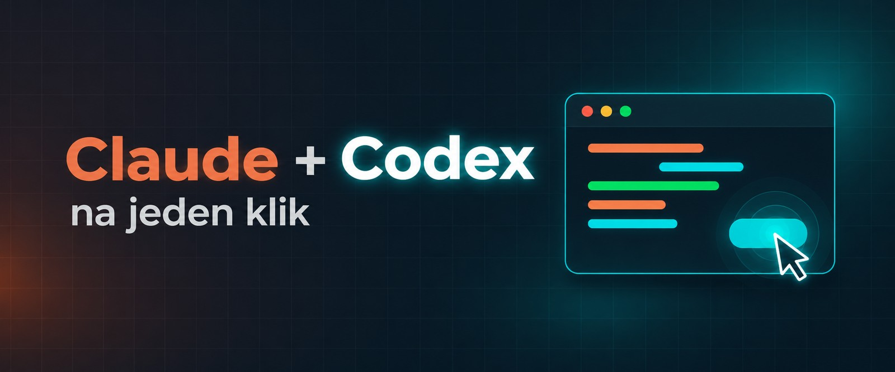
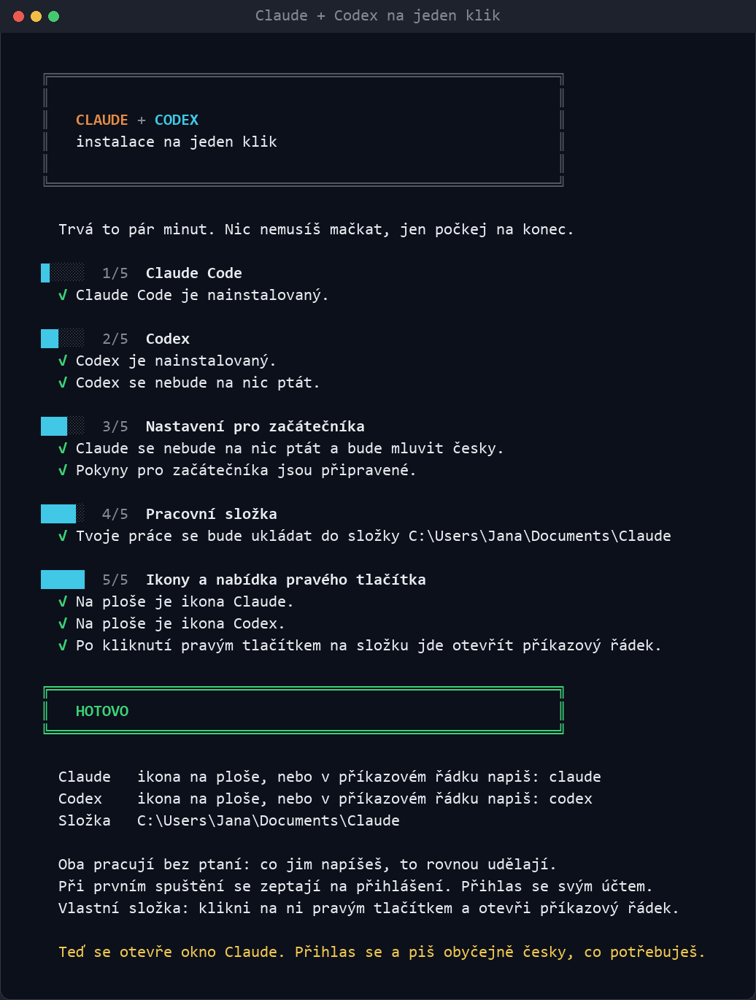

<p align="center">
  
</p>

<h1 align="center">Claude + Codex na jeden klik</h1>

<p align="center">
  Jeden soubor, dvě kliknutí. Do Windows se nainstaluje <a href="https://code.claude.com/docs">Claude Code</a> i <a href="https://developers.openai.com/codex/cli">Codex</a><br>
  a oba se nastaví tak, aby s nimi mohl pracovat i člověk, který příkazový řádek nikdy neviděl.
</p>

<p align="center">
  <a href="https://github.com/Promptlab37/claude-na-jeden-klik/releases/latest/download/Instalovat-Claude.bat"><b>⬇ Stáhnout instalátor</b></a>
</p>

<p align="center">
  
  
  
</p>

## Proč to vzniklo

Nainstalovat Claude Code a Codex ručně znamená otevřít PowerShell, spustit dva různé příkazy, opravit proměnnou PATH a pak ještě odklikat anglické dotazy při prvním spuštění. Začátečník se na tom často zasekne dřív, než cokoli vyzkouší. Tenhle instalátor to celé udělá za něj.

## Co dostaneš

- **Claude Code a Codex** nainstalované oficiálními instalátory Anthropicu a OpenAI
- **práci bez potvrzování**: co nástroji napíšeš, to rovnou udělá
- **Claude mluvící česky** a s pokyny, jak jednat se začátečníkem
- **ikony na ploše** a složku `Claude` v Dokumentech, kam se ukládá tvoje práce
- **položku „Otevřít v příkazovém řádku“** po kliknutí pravým tlačítkem na jakoukoli složku

## Co potřebuješ

- Windows 10 verze 1809 nebo novější, případně Windows 11 (64bitová verze)
- internet a aspoň 1 GB volného místa na disku
- účet Claude pro Claude Code (předplatné Pro nebo vyšší, případně API klíč). Bezplatný účet Claude Code nezahrnuje.
- účet ChatGPT pro Codex

## Instalace

1. **[Stáhni soubor Instalovat-Claude.bat](https://github.com/Promptlab37/claude-na-jeden-klik/releases/latest/download/Instalovat-Claude.bat)**
2. Dvakrát na něj klikni.
3. Když Windows napíše „Systém Windows ochránil váš počítač“, klikni na **Další informace** a pak na **Přesto spustit**.
4. Počkej pár minut, než instalace doběhne. Nic dalšího mačkat nemusíš.

<p align="center">
  
</p>

## První spuštění

Na konci instalace se otevře okno Claude. Zeptá se na vzhled (stačí Enter) a na přihlášení. Vyber, jak se chceš přihlásit, v prohlížeči to potvrď a vrať se do okna.

Codex spustíš ikonou **Codex** na ploše nebo slovem `codex` v příkazovém řádku. Na přihlášení se zeptá také sám.

Instalátor nikoho nepřihlašuje a na žádné API klíče nesahá. Jak se přihlásíš, je na tobě.

## Práce ve vlastní složce

1. Založ si novou složku, kde chceš něco stavět.
2. Klikni na ni pravým tlačítkem a zvol **Otevřít v příkazovém řádku**. Ve Windows 11 ji najdeš pod **Zobrazit další možnosti**, nebo rovnou zvol **Otevřít v terminálu**.
3. Napiš `claude` nebo `codex` a stiskni Enter.

## Dobré vědět

**Claude ani Codex se na nic neptají.** Je to tak nastavené záměrně, aby začátečník nemusel rozumět anglickým dotazům. Co nástroji napíšeš, to rovnou udělá, včetně práce se soubory a programy v počítači. Proto:

- Dej přesné zadání a důležité soubory si zálohuj.
- Nepoužívej je na firemním počítači ani na počítači s citlivými daty, pokud to nemáš povolené.
- Nenechávej je zpracovávat weby a soubory, kterým nevěříš. Může se v nich schovávat škodlivý pokyn a tady ho nikdo nepotvrzuje. Oficiální dokumentace tento režim doporučuje jen pro izolované prostředí.
- Nespouštěj je ve složkách stažených z neznámých zdrojů ani na cizím flash disku. Claude má dotaz na důvěru složky vypnutý pro všechny disky.

Chceš, aby se ptaly?

- **Claude:** v souboru `.claude\settings.json` ve své uživatelské složce změň `defaultMode` na `default`, nebo v okně Claude přepínej režimy klávesami `Shift+Tab`.
- **Codex:** v souboru `.codex\config.toml` smaž řádky `approval_policy` a `sandbox_mode`, nebo v okně Codexu napiš `/permissions`.

## Co přesně instalátor mění

Práva správce nepotřebuje, vše se děje jen ve tvém uživatelském účtu. Před každou změnou existujícího nastavení udělá zálohu vedle původního souboru.

| Krok | Co se změní |
|---|---|
| Claude Code | Spustí [oficiální instalátor Anthropicu](https://claude.ai/install.ps1), pokud v `.local\bin` ještě funkční Claude není. Claude nainstalovaný jinou cestou (například přes npm) nechá úplně být. |
| Codex | Spustí [oficiální instalátor OpenAI](https://chatgpt.com/codex/install.ps1), pokud Codex v počítači ještě není. Když se to nepovede, Claude se nainstaluje i tak. |
| PATH | Přidá `%USERPROFILE%\.local\bin` do proměnné PATH uživatele. Když v počítači v PATH chybí systémové složky Windows, doplní je tam také. |
| Nastavení Claude | Do `.claude\settings.json` zapíše režim bez ptaní (`bypassPermissions`), češtinu a pár zákazů (například formátování disku). Vytvoří `.claude\CLAUDE.md` s pokyny pro práci se začátečníkem, pokud tam ještě žádné nejsou. |
| Nastavení Codexu | Do `.codex\config.toml` zapíše `approval_policy = "never"` a `sandbox_mode = "danger-full-access"` a označí pracovní složku jako důvěryhodnou. |
| První spuštění Claude | V `.claude.json` označí pracovní složku i kořeny všech disků jako důvěryhodné. Pokud už jsi v Claude přihlášený, tento soubor nemění. |
| Složka a ikony | Vytvoří složku `Claude` v Dokumentech a ikony **Claude** a **Codex** na ploše. Oba nástroje se otevírají v této složce. |
| Pravé tlačítko | Přidá do nabídky složek položku „Otevřít v příkazovém řádku“ (klíč `ClaudePrikazovyRadek` v `HKCU\Software\Classes`). |

Zákazy v nastavení Claude jsou jen základní pojistka proti běžnému tvaru příkazu, nejsou to bezpečnostní hranice.

## Když něco nejde

| Potíž | Co s tím |
|---|---|
| Soubor `.bat` nejde spustit, Windows ho nepustí ani přes „Další informace“, nebo ho smazal antivirus | Otevři nabídku Start, napiš `PowerShell`, otevři ho a vlož řádek uvedený pod tabulkou. Udělá totéž co soubor `.bat`. |
| Okno instalace se zastavilo | Klikni do něj a stiskni Enter. Kliknutí myší do okna výpis pozastaví. |
| „Na disku je jen … MB volného místa“ | Uvolni aspoň 1 GB a spusť instalátor znovu. |
| V příkazovém řádku nejde `claude` nebo `codex` | Zavři okno příkazového řádku a otevři nové. Okna otevřená před instalací o nových programech nevědí. |
| Codex se nenainstaloval | Instalátor to napíše a Claude nainstaluje i tak. Spusť instalátor později znovu, hotové kroky přeskočí. |
| Instalace skončila červeným rámečkem | Vyfoť obrazovku a pošli ji tomu, kdo ti instalátor doporučil, nebo ji vlož do [nového hlášení](https://github.com/Promptlab37/claude-na-jeden-klik/issues/new). |

```powershell
irm https://raw.githubusercontent.com/Promptlab37/claude-na-jeden-klik/main/install.ps1 -OutFile "$env:TEMP\claude-instalace.ps1"; & "$PSHOME\powershell.exe" -NoProfile -ExecutionPolicy Bypass -File "$env:TEMP\claude-instalace.ps1"
```

Instalátor můžeš pustit opakovaně. Co už je hotové, přeskočí.

## Odinstalace

Nástroje odinstaluješ podle oficiálních návodů pro [Claude Code](https://code.claude.com/docs/en/setup) a [Codex](https://developers.openai.com/codex/cli). Ikony a složku `Claude` pak můžeš smazat ručně. Položku z nabídky pravého tlačítka odstraníš v příkazovém řádku:

```
reg delete "HKCU\Software\Classes\Directory\shell\ClaudePrikazovyRadek" /f
reg delete "HKCU\Software\Classes\Directory\Background\shell\ClaudePrikazovyRadek" /f
```

## Je to bezpečné?

Celý instalátor jsou dva čitelné soubory: [`Instalovat-Claude.bat`](Instalovat-Claude.bat) si stáhne [`install.ps1`](install.ps1) z tohoto repozitáře a spustí ho. Ten stahuje jen oficiální instalátory z `claude.ai` a `chatgpt.com`. Nic neposílá, nesbírá žádné údaje a nepotřebuje práva správce.

## O projektu

Nástroj vznikl v [PromptLabu](https://promptlab.cz) pro školení a pro kamarády, kteří chtějí s AI začít bez boje s instalací. Je neoficiální a není spojený se společnostmi Anthropic ani OpenAI. Claude a Codex jsou ochranné známky svých vlastníků.

Licence [MIT](LICENSE).
